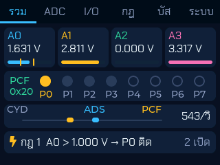
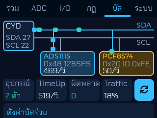
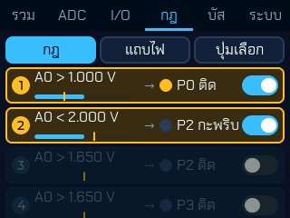
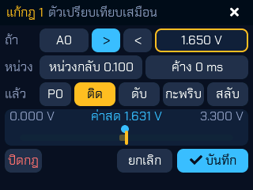
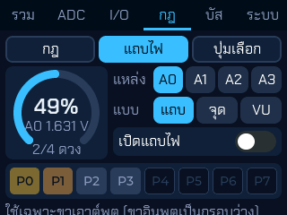
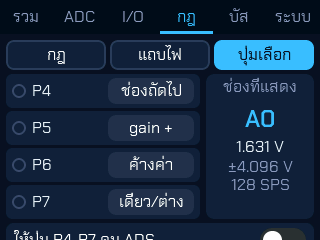
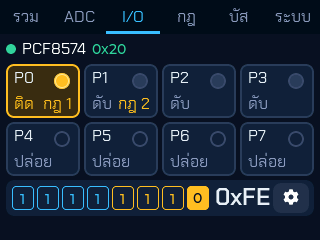
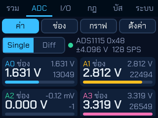
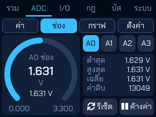
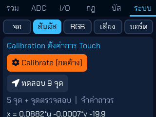

# Lab ADS + PCF Combo — ADC 4 ช่อง + I/O 8 ขา บนบัส I2C เดียว (branch `feature/ads-pcf-combo`)

แล็บรวมของ **ESP32 CYD Dev Level 2** (บอร์ด ESP32-2432S028 จอ 2.8" 320x240 + จอสัมผัส XPT2046 + LVGL 8.3)
นำสองแล็บที่ทดสอบแล้วมาต่อบนสายคู่เดียวกัน แล้วให้ทั้งสองชิป "คุยกัน" ผ่านกฎ

- **ADS1115 / ADS1015**: ADC 4 ช่อง 16/12 บิต (จาก `feature/ads1115-analog`)
- **PCF8574 / PCF8574A**: ขา I/O 8 ขา (จาก `feature/pcf8574-io`)
- **กฎข้ามชิป**: ค่าแอนะล็อกเกินขีด → สั่งขา PCF (ตัวเปรียบเทียบ/รีเลย์เสมือน), แถบไฟตามค่า, ปุ่มบน PCF เลือกช่อง/gain ของ ADS
- **แผนภาพบัสที่เคลื่อนไหว**: แพ็กเก็ตวิ่งระหว่าง CYD, ADS และ PCF ตามธุรกรรมจริง พร้อมสถิติ

แตกมาจาก `feature/ads1115-analog` (16e73f8) จึงได้หน้า **ระบบ > สัมผัส (Calibration 5 จุด + จุดตรวจสอบ + ทดสอบ 9 จุด)** มาด้วย
แบบหน้าจอที่อาจารย์อนุมัติ: https://claude.ai/artifact/TcZqX2msMBvDds7r6FooKd

---

## 1. หน้าจอ (ภาพจากบอร์ดจริง ถ่ายผ่าน Serial)

แท็บ: **รวม | ADC | I/O | กฎ | บัส | ระบบ**

| | |
|---|---|
|  **รวม** การ์ด A0-A3 (แถบเลื่อนนุ่ม + ขีดส้มของกฎ), ไฟ P0-P7 (ขาที่ติดมีวงแสงกระเพื่อม แตะ = สลับ), บัสย่อ (จุดวิ่งตามอัตราจริง), กฎที่ทำงานล่าสุด (กะพริบ + ⚡ เด้งเมื่อกฎเริ่มทำงาน) |  **บัส** แผนภาพ SDA/SCL, แพ็กเก็ตวิ่ง (ฟ้า = เขียน ADS, เขียว = อ่าน ADS, ส้ม = เขียน PCF, เขียวน้ำทะเล = อ่าน PCF, แดง = ไม่มี ACK), กล่องชิปกะพริบเมื่อมีธุรกรรม, อุปกรณ์ / **TimeUp** (ธุรกรรมต่อวินาที) / ผิดพลาด / **Traffic** (% เวลาที่บัสไม่ว่าง) |
|  **กฎ > กฎ** 8 กฎ: เงื่อนไข + แถบค่าสด + ขีด + ไฟปลายทาง + สวิตช์ กฎที่ทำงานขอบส้มและกะพริบ |  **แก้กฎ** (เลื่อนขึ้นจากล่าง) ช่อง, >/<, ขีด (แป้นตัวเลข หรือ **ลากเส้นส้ม**), หน่วงกลับ (ฮิสเทอรีซิส), ค้างกี่ ms, ขา + ติด/ดับ/กะพริบ/สลับ |
|  **กฎ > แถบไฟ** เกจโค้งของช่องที่เลือก → ไฟบนขาเอาต์พุตทุกขา แบบ แถบ / จุด / VU (ปิดอยู่ = แสดงตัวอย่างจางๆ) |  **กฎ > ปุ่มเลือก** ปุ่ม P4-P7 สั่ง ADS: ช่องถัดไป / gain + / gain - / ค้างค่า / เดี่ยว-ต่าง (ชื่อช่องเลื่อนเปลี่ยนแบบมีภาพเคลื่อนไหว) |
|  **I/O** 8 ขาของ PCF (แตะ = สลับ + ยุบ-เด้ง) ป้าย "กฎ N"/"แถบ"/"มือ" บอกว่าใครคุมขา, ไบต์พอร์ตจริง, ปุ่มเฟือง = ตั้งทิศทาง/ทำงานเมื่อ LOW |  **ADC > ค่า** หน้าจากแล็บ ADS (Single/Diff) มีปุ่มย่อย ค่า / ช่อง / กราฟ / ตั้งค่า |
|  **ADC > ช่อง** เกจ + ต่ำสุด/สูงสุด/เฉลี่ย/ค่าดิบ |  **ระบบ > สัมผัส** Calibration ตั้งค่าการ Touch (5 จุด + จุดตรวจสอบ) + ทดสอบ 9 จุด (ส่วนจอ / RGB / เสียง / บอร์ด อยู่ปุ่มข้างๆ) |

ภาพเคลื่อนไหวทั้งหมดใช้ `lv_anim` เปลี่ยน outline / transform / สีพื้น / ตำแหน่ง เท่านั้น **ไม่ใช้เงา** (เงาจองบัฟเฟอร์ทุกครั้งที่วาด)
และแท็บ/ส่วนย่อยเลื่อนเข้าแบบจาง (slide-in) ทุกครั้งที่เปลี่ยน

---

## 2. การต่อวงจร: สองชิปบนบัสเดียว (ไฟ 3.3V เท่านั้น)

```
           CYD (CN1 / P3)                 ADS1115 / ADS1015          PCF8574 (บอร์ดสีน้ำเงิน)
   3.3V ─────────────┬──────────────────── VDD ──────────────────────── VCC
   GND  ─────────────┼──────────────────── GND ──────────────────────── GND
   IO27 (SDA) ───────┼──────────────────── SDA ──────────────────────── SDA
   IO22 (SCL) ───────┼──────────────────── SCL ──────────────────────── SCL
   IO35 (INT ร่วม) ──┼──────────────────── ALRT (ไม่บังคับ) ─────────── INT (ไม่บังคับ)
                     └── 10 kΩ ── 3.3V   (pull-up ของ IO35 ตัวเดียวพอ)
                                           ADDR → GND = 0x48          A0-A2 → GND = 0x20
```

| สาย | CYD | ADS1x15 | PCF8574 |
|---|---|---|---|
| ไฟ | 3.3V (CN1 ขา 1) | VDD | VCC |
| กราวด์ | GND | GND | GND |
| SDA | **IO27** (CN1 ขา 2) | SDA | SDA |
| SCL | **IO22** (P3 ขา 2 หรือ CN1 ขา 3 บนบอร์ด 2-USB) | SCL | SCL |
| INT ร่วม (ไม่บังคับ) | **IO35** (P3) + **10 kΩ จาก IO35 ไป 3.3V** | ALRT | INT |
| ขาสัญญาณ | — | A0-A3 = แรงดัน 0-3.3 V | P0-P3 LED แบบ sink (3.3V-330Ω-LED-ขา), P4-P7 ปุ่มลง GND |

**ทำไมต่อร่วมกันได้**
- **address ไม่ชนกัน**: ADS1x15 ใช้ 0x48-0x4B (ตามขา ADDR), PCF8574 ใช้ 0x20-0x27 และ PCF8574A ใช้ 0x38-0x3F (ตาม A0-A2)
  บัส I2C แยกอุปกรณ์ด้วย address อย่างเดียว ต่อขนานกันได้หลายตัว (แท็บบัสแสดงรายการที่สแกนพบ)
- **pull-up ของ SDA/SCL**: โมดูลทั้งสองมี pull-up ของตัวเองอยู่แล้ว ต่อขนานกัน = ความต้านทานรวมลดลง (เช่น 10k ‖ 10k = 5k) ยังใช้ได้ดี
  ถ้าต่อโมดูลมากกว่า 3-4 ตัว ให้ถอด pull-up บางตัวออก
- **INT/ALRT เป็น open-drain ทั้งคู่**: แต่ละตัว "ดึงลง" ได้อย่างเดียว ปล่อยไว้ = ลอย จึงต่อรวมเป็นสายเดียวได้ (wired-OR):
  ขา IO35 เป็น LOW เมื่อ **ตัวใดตัวหนึ่ง** เรียก → เฟิร์มแวร์ต้อง **ถามทั้งสองตัว** (อ่านพอร์ต PCF + อ่านบิต OS ของ ADS)
  ไม่เชื่อขาอย่างเดียวเหมือนแล็บเดี่ยว
- **IO35 เป็น input-only และไม่มี pull-up ภายใน** → ต้องต่อ **10 kΩ จาก IO35 ไป 3.3V** เอง (ตัวเดียวพอสำหรับทั้งสองชิป)
  ไม่ต่อ = ขาลอยอ่านได้ LOW ตลอด เฟิร์มแวร์จะเห็น "INT ค้าง LOW" แล้วถอยไปอ่านแบบ polling เอง
- **ความเร็วบัส**: PCF8574 รองรับสูงสุด **100 kHz** ตาม datasheet ส่วน ADS1x15 ได้ถึง 400 kHz
  บัสร่วมจึงตั้งค่าเริ่มต้นเป็น **100 kHz** (ตัวที่ช้าที่สุดเป็นตัวกำหนด) สลับเป็น 400 kHz ได้ที่แท็บบัสเพื่อเปรียบเทียบ (เกินสเปกของ PCF)

ห้ามใช้ **IO21** (ไฟหลังจอ) และห้ามจ่าย 5V ให้โมดูล (SDA/SCL จะเป็น 5V เข้าขา ESP32)
ขา A0-A3 ของ ADS ห้ามเกิน 3.3 V + 0.3 V แม้ตั้ง PGA ±6.144 V

---

## 3. เริ่มใช้งาน

1. เปิดโฟลเดอร์นี้ใน VS Code + PlatformIO เลือก env ให้ตรงจอ: `cyd` (ILI9341) หรือ `cyd_st7789` (ST7789)
2. Upload: บอร์ดที่เคยใช้แล็บอื่นของคอร์สจำค่า calibrate ไว้แล้ว (NVS `labstart`) บอร์ดใหม่จะเข้าหน้า calibrate เองหลัง splash
3. แท็บรวมต้องเห็น A0-A3 และ `PCF 0x20` สีเขียว แท็บบัสต้องเห็น "2 ตัว"
4. ค่าเริ่มต้นมีกฎตัวอย่าง 2 กฎ: **A0 > 1.65 V → P0 ติด** และ **A0 > 2.8 V → P1 กะพริบ** หมุนโพเทนชิโอที่ A0 ผ่านกลางช่วงแล้ว LED P0 ต้องติด

```bash
python -m platformio run -e cyd -t upload --upload-port COM7
```

(ถ้า `python` ในเครื่องไม่ใช่ของ PlatformIO ใช้ปุ่ม Upload ใน VS Code หรือ `%USERPROFILE%\.platformio\penv\Scripts\python.exe -m platformio ...`)

---

## 4. ความรู้: ทำงานอย่างไร

### บัสเดียว เจ้าของคนเดียว: task "i2c"
`Wire` ของ ESP32 ใช้ได้ทีละงาน ถ้า UI (core 1) กับงานอ่าน ADS (core 0) เรียกพร้อมกัน ธุรกรรมจะพันกัน
แล็บนี้จึงให้ **task "i2c" บน core 0 เป็นเจ้าของบัส** และทุกฟังก์ชันที่แตะบัสถือ `BusGuard` (recursive mutex ตัวเดียว) ก่อน

```
loop ของ task "i2c" (hal_bus.cpp)
  ├─ adsService()   เริ่มแปลงช่องถัดไป / อ่านผลที่เสร็จ   (ยังไม่ถึงเวลาเสร็จ = ไม่ถามชิป)
  ├─ pcfService()   อ่านปุ่ม P4-P7 (polling ทุก 20 ms หรือเมื่อ IO35 ลง LOW)
  ├─ rulesService() ค่า ADS ล่าสุด → คำนวณขาออก → เขียน PCF เฉพาะเมื่อเปลี่ยน
  └─ หลับ ≤ 5 ms  (ระหว่างที่ ADS กำลังแปลง ~8 ms บัสว่าง: PCF ใช้ช่องว่างนี้)
```

ทุกธุรกรรมผ่าน `busWrite()/busRead()` ซึ่งนับสถิติ (ต่อชิป, ผิดพลาด, เวลาที่บัสไม่ว่าง) และเก็บ "แพ็กเก็ต" ลงวงแหวน 32 ช่อง
ให้แท็บบัสหยิบไปวาด (วาดทุกอันไม่ไหว จึงสุ่มมาวาด ~8 ครั้ง/วินาทีต่อชิป)

### อย่าถามชิปก่อนเวลา
ADS1115 ที่ 128 SPS แปลง 1 ครั้งใช้ ~7.8 ms ถ้าวนถามบิต OS ทุก 1 ms จะเปลือง 2 ธุรกรรมต่อครั้งบนบัสที่ PCF ใช้ร่วม
วัดจริง: ก่อนแก้ ~12 ธุรกรรมต่อค่า 1 ค่า (บัส 1,250 ครั้ง/วินาที, ไม่ว่าง 41%) หลังแก้ให้หลับจนถึงเวลาเสร็จก่อนค่อยถาม
เหลือ ~5 ธุรกรรมต่อค่า (534 ครั้ง/วินาที, ไม่ว่าง 18%) ได้ค่าเท่าเดิม ~96 ค่า/วินาที

### กฎ = ตัวเปรียบเทียบเสมือน (virtual comparator)
```
ถ้า  A0  >  1.650 V        (หรือ <)
หน่วงกลับ 0.100 V          ทำงานที่ 1.650 แต่เลิกทำงานเมื่อลงต่ำกว่า 1.550 (กันไฟกะพริบตอนค่าแกว่งรอบขีด)
ค้าง 200 ms                 เงื่อนไขต้องจริง/เท็จต่อเนื่องนานเท่านี้ก่อนเปลี่ยน (กันสัญญาณรบกวนสั้นๆ)
แล้ว P0  ติด / ดับ / กะพริบ / สลับ
```
- ขาเดียวมีหลายกฎ: กฎลำดับหลังทับกฎก่อน / **แถบไฟชนะกฎ** บนขาเอาต์พุตทุกขาเมื่อเปิด
- แตะขาที่กฎคุมอยู่ (แท็บ I/O หรือแท็บรวม) = **ยึดคืนชั่วคราว** (ป้าย "มือ") จนกว่ากฎของขานั้นจะเปลี่ยนสถานะครั้งถัดไป
- ขีดเป็น "หน่วยของช่อง" ตามที่ตั้งในแท็บ ADC > ตั้งค่า (เช่น °C, %) ไม่ใช่แรงดันดิบ
- เก็บถาวรใน NVS key `rules` (8 กฎ + แถบไฟ + ปุ่มเลือก + ช่องที่เลือก)

### แถบไฟ (LED bar graph)
ค่าของช่องที่เลือก แปลงเป็น 0-100% ของช่วงวัด แล้วกระจายไปที่ขาเอาต์พุตเรียงจาก P0 ขึ้นไป (ขาอินพุตถูกข้าม)
- **แถบ**: ติดตั้งแต่ดวงแรกถึงดวงที่ % ไปถึง / **จุด**: ติดดวงเดียว / **VU**: แถบ + จุดสูงสุดค้าง 0.6 วินาทีแล้วค่อยๆ ลง

### ปุ่มบน PCF สั่ง ADS
ขอบกด (ปล่อย → กด) ของ P4-P7 เรียกคำสั่งที่เลือกไว้: ช่องถัดไป, gain + (ช่วงวัดแคบลง ละเอียดขึ้น), gain −, ค้างค่า, สลับเดี่ยว/ต่าง
คำสั่งที่เปลี่ยนค่าตั้ง ADS บันทึกลง NVS ทันทีและหน้าจอทุกหน้าสร้างป้ายใหม่เอง

### INT/RDY ร่วมที่ IO35
สวิตช์ RDY/INT ไม่อยู่บนหน้าจอแล้ว (หน้า บัส เหลือ ความเร็ว + โหมดจำลอง + สถานะ IO35) เปิด-ปิดผ่าน Serial แทน
- ADS: เปิดโหมด RDY (Serial `m`) แล้ว ADS ดึงขาลงเมื่อแปลงเสร็จ แต่เพราะ PCF ก็ดึงขาเดียวกันได้ เฟิร์มแวร์จึง **ยืนยันด้วยบิต OS ทุกครั้ง**
  และหลังอ่านผลจะเริ่มแปลงครั้งถัดไปทันที ขา RDY จึงกลับเป็น HIGH ก่อนถึงคิว PCF
- PCF: เปิดโหมด INT (Serial `#int 1`) แล้ว PCF ถูกอ่านเฉพาะตอน IO35 เป็น LOW (+ อ่านกันพลาดทุก 1 วินาที)
  ไม่ใช้ interrupt (`attachInterrupt`) เพราะ ADS ก็ทำให้เกิดขอบขาลงทุกครั้งที่แปลงเสร็จ
- IO35 LOW ค้างนานกว่า 1 วินาที (ไม่มี pull-up / สายลัด) → ขึ้นคำเตือนที่แท็บบัส และ PCF ถอยไปอ่านทุก 20 ms แทนการอ่านทุกรอบ

### RAM: สร้างเมื่อเปิดดู ลบเมื่อออก
สร้างทุกหน้าพร้อมกันแล้ว heap หมดตอนบูต (บอร์ดรีบูตวน `abort()` ใน `lv_obj_allocate_spec_attr`) จึงทำแบบ lazy:
- แท็บ ADC / กฎ / ระบบ สร้างเฉพาะส่วนย่อยที่เปิดดู แล้วลบ (`lv_obj_del_async`) เมื่อเปลี่ยนส่วน
- แท็บระบบจด "ตัวจับเวลาที่เกิดระหว่างสร้าง" ไว้แล้วลบพร้อม widget (ไม่ต้องแก้ไฟล์ของส่วนนั้น)
- หน้าตั้งขา PCF และหน้าแก้กฎเป็นหน้าเต็มจอที่สร้างเมื่อเปิดเท่านั้น
- ผลข้างเคียง: กราฟเริ่มวาดใหม่ทุกครั้งที่กลับเข้าหน้ากราฟ

| หน่วยความจำ (วัดจริง) | ค่า |
|---|---|
| ใช้ RAM ตอน build | 24.7% (81 KB static, รวมบัฟเฟอร์วาด 2 x 40 บรรทัด) / Flash 22.9% |
| heap8 หลังสร้างครบ 6 แท็บ | 67 KB (ก้อนใหญ่สุด 63 KB) |
| `[STATUS] heap` ตอนเดินครบทุกหน้า | 118-134 KB, ต่ำสุด 89 KB |
| หน้าที่ใหญ่ที่สุด | ADC > ตั้งค่า ~30 KB, กฎ > กฎ ~22 KB, ระบบ > สัมผัส ~18 KB |

### แยกชั้น HAL / UI
`hal_*.cpp` ไม่รู้จัก LVGL (ทำงานใน task "i2c") ส่วน `ui_*.cpp` อ่านสถานะจาก `hal::bus()/ads()/pcf()/rules()` ผ่าน `lv_timer`
callback ปุ่มของ PCF (`pcfOnInputChange`) ถูกเรียกจาก task "i2c" จึงเรียกได้แค่ `soundClick()` (ส่งผ่านคิว) ห้ามเรียก `lv_*`

---

## 5. คำสั่ง Serial (115200)

| คำสั่ง | ทำอะไร |
|---|---|
| `h` / `i` | ช่วยเหลือ / สถานะ (`[STATUS]` ทุก 5 วินาที) |
| `b` | สถานะบัส + PCF (ธุรกรรมต่อวินาทีแยกชิป, ผิดพลาด, % ไม่ว่าง, ระดับ IO35) |
| `n` | สแกนบัสใหม่ (ADS + PCF) |
| `a` / `v` / `z` | สถานะ ADS / ค่าทุกช่อง / รีเซ็ตสถิติ |
| `m` / `x` / `D` | ADS polling↔RDY / เดี่ยว↔ต่าง / โหมดจำลอง |
| `u` | พิมพ์กฎทั้ง 8 + แถบไฟ + ปุ่มเลือก |
| `0`-`5` | เปิดแท็บ ADC > ช่อง ที่ช่องนั้น |
| `#clk 0\|1` | บัส 100 / 400 kHz |
| `#out P 0\|1`, `#tog P`, `#dir P 1\|0`, `#low P 0\|1`, `#int 0\|1`, `#pcfreset` | สั่งขา / สลับ (เหมือนแตะ) / ทิศทาง / ทำงานเมื่อ LOW / โหมด INT / ค่าเริ่มต้น |
| `#rule N EN SLOT ABOVE THR PIN ACT [HYST HOLDMS]` | ตั้งกฎ N (1-8) เช่น `#rule 1 1 0 1 1.0 0 0` = A0 > 1.0 → P0 ติด (ACT 0 ติด 1 ดับ 2 กะพริบ 3 สลับ) |
| `#bar 0\|1 MODE`, `#sel SLOT`, `#in 0\|1`, `#hold 0\|1`, `#rdef` | แถบไฟ (0 แถบ 1 จุด 2 VU) / ช่องที่เลือก / ปุ่มเลือก / ค้างค่า / กฎค่าเริ่มต้น |
| `#edit N` | เปิดหน้าแก้กฎ N |
| `#tab 0-5`, `#adc 0-3`, `#rsub 0-2`, `#sub 0-4`, `#set 0-1`, `#scroll Y` | เปลี่ยนแท็บ / ส่วนย่อย ADC / กฎ / ระบบ / ตั้งค่า ADC / เลื่อนแท็บปัจจุบันลง Y px (ใช้ถ่ายภาพ) |
| `#gain` `#rate` `#avg` `#chip` `#addr` `#beep` `#hi` `#lo` `#scale` `#key` | ค่าตั้ง ADS (เหมือนแล็บ ADS) |
| `c` `k` `d` `r` `t` `l` `s` `S` | calibrate / ดูค่า calibrate / จอ / รีเซ็ตจอ / ค่าดิบสัมผัส / ทดสอบ LED / เสียง / ภาพหน้าจอ |

---

## 6. ค่าที่ปรับได้ใน `include/app_config.h`

| ค่า | เริ่มต้น | ความหมาย |
|---|---|---|
| `I2C_FREQ_SLOW_HZ` / `I2C_FREQ_FAST_HZ` | 100000 / 400000 | ความเร็วบัสสองแบบที่สลับได้บนจอ |
| `I2C_TASK_MAX_SLEEP_MS` | 5 | task i2c หลับนานสุด (= ปุ่ม/กฎตอบสนองช้าสุด) |
| `PCF_POLL_MS` / `PCF_INT_SAFETY_MS` | 20 / 1000 | อ่านปุ่มทุกกี่ ms / โหมด INT อ่านกันพลาดทุกกี่ ms |
| `RULE_EVAL_MS` / `RULE_BLINK_MS` | 10 / 250 | ตรวจกฎทุกกี่ ms / กะพริบครึ่งรอบ |
| `BAR_PEAK_HOLD_MS` / `BAR_PEAK_FALL_MS` | 600 / 150 | VU ค้างยอด / ลดลงดวงละกี่ ms |
| `ADS_*`, `TOUCH_*`, `CAL_*` | ตามแล็บ ADS | เหมือนเดิม |

---

## 7. ไฟล์ (เทียบกับ `feature/ads1115-analog` ที่แตกมา)

| ไฟล์ | |
|---|---|
| `src/hal_bus.cpp` | **ใหม่** บัสร่วม: mutex, busWrite/busRead + สถิติ + วงแหวนแพ็กเก็ต, สแกน, 100/400 kHz, task "i2c" |
| `src/hal_ads.cpp` | ใช้ BusGuard/busWrite, `adsService()` แทน task ของตัวเอง, RDY ยืนยันด้วยบิต OS, ไม่ถามก่อนเวลา |
| `src/hal_pcf8574.cpp` | จากแล็บ PCF: ผ่าน busWrite/busRead, INT ดูระดับขาแทน interrupt, ถอยเป็น polling เมื่อ INT ค้าง |
| `src/hal_rules.cpp` | **ใหม่** กฎ 8 ข้อ (ฮิสเทอรีซิส + หน่วงเวลา), แถบไฟ 3 แบบ, ปุ่ม P4-P7 สั่ง ADS, ยึดขาคืนด้วยมือ |
| `src/ui_dash.cpp` | **ใหม่** แท็บรวม |
| `src/ui_adc.cpp` | **ใหม่** แท็บ ADC (สร้างทีละส่วน) ครอบ ui_overview / ui_detail / ui_chart / ui_settings |
| `src/ui_io.cpp`, `src/ui_pins.cpp` | จากแล็บ PCF + ป้ายผู้คุมขา + ภาพเคลื่อนไหว, ตั้งขาเป็นหน้าเต็มจอ (ตัดไฟวิ่ง/นับเลข ใช้แถบไฟแทน) |
| `src/ui_rules.cpp` | **ใหม่** แท็บกฎ (กฎ / แถบไฟ / ปุ่มเลือก) + หน้าแก้กฎ |
| `src/ui_busmap.cpp` | **ใหม่** แท็บบัส (แทน `ui_bus.cpp` ของแล็บ ADS) |
| `src/ui_sys.cpp` | สร้างทีละส่วน + จดตัวจับเวลาของส่วนนั้นไว้ลบ |
| `src/ui_main.cpp` | 6 แท็บใหม่ + ฟังก์ชันภาพเคลื่อนไหว `ui_pulse / ui_pop / ui_flash / ui_bar_anim / ui_slide_in` |
| `docs/PROMPTS_ADS_PCF_COMBO_LAB.md` | ชุด prompt / บทเรียนทีละขั้น |

NVS namespace `labstart` ใช้ร่วมกับทุกแล็บ: `cal`, `disp`, `bl`, `vol`, `adscfg`, `adsch` (จากแล็บ ADS), `pcfdir`, `pcflow`, `pcfint` (จากแล็บ PCF),
ใหม่: `busfast`, `rules`

---

## 8. ผลการทดสอบ (2026-10-28, บอร์ด ILI9341 ที่ COM7, ADS1115 จริงที่ 0x48 + PCF8574 จริงที่ 0x20 บนสายคู่เดียวกัน)

ทดสอบผ่าน Serial (`tools/serial_plan.py`) และภาพหน้าจอจริง (`S`) แล้วผู้สอนลองแตะจอ กดปุ่ม และดู LED บนบอร์ดเอง (ยืนยัน "ใช้ได้")

| รายการ | ผล | วิธีตรวจ |
|---|---|---|
| build `cyd` / `cyd_st7789` | ✅ ผ่านทั้งคู่ (RAM 24.7%, Flash 22.9-23.0%) | PlatformIO |
| สแกนพบ 2 ตัวบนบัสเดียว, ตรวจรุ่น ADS1115 (1.5 ms) | ✅ | log `[BUS] scan: 2 device(s) 0x20 0x48` |
| task "i2c" ใช้บัสร่วม ไม่มีธุรกรรมผิดพลาด | ✅ 0 error ใน ~45 วินาที (≈ 47,000 ธุรกรรม) | `b` |
| อัตรา @100 kHz, 128 SPS | ✅ ADS 96 ค่า/วินาที, บัส 534 ครั้ง/วินาที, ไม่ว่าง 18% | `b`, `a` |
| อัตรา @100 kHz, 860 SPS | ✅ บัส 1,713 ครั้ง/วินาที, ไม่ว่าง 58%, 0 error | `#rate 7` แล้ว `b` |
| สลับ 400 kHz | ✅ 0 error ใน ~5 วินาที (ADS 111 ค่า/วินาที ก่อนแก้เรื่องถามก่อนเวลา) | `#clk 1` แล้ว `b` |
| กฎ "A0 > 1.0 → P0 ติด" | ✅ กฎทำงาน ไบต์พอร์ต PCF = 0xFE (P0 ดึงลง) | `#rule` + `u` + `b` |
| กฎ "A0 < 2.0 → P2 กะพริบ" | ✅ ไบต์ออกสลับ 0x05 / 0x01 | `b` หลายครั้ง |
| แถบไฟ แถบ / จุด / VU (A0 = 49%) | ✅ ออก 0x03 / 0x02 / 0x03 (2 ใน 4 ดวง) | `#bar 1 0/1/2` + `b` |
| ยึดขาคืนด้วยมือ | ✅ `#tog 0` → manual=0x01, P0 ดับทั้งที่กฎยังทำงาน | `u` |
| เปิดครบทุกแท็บ/ส่วนย่อย + หน้าแก้กฎ ไม่ค้าง | ✅ heap ต่ำสุด 89 KB ไม่มี `[LVMEM]`/Guru | serial_plan เดินทุกหน้า |
| หน้าจอทุกหน้าที่อยู่ในหัวข้อ 1 | ✅ ภาพจริงจากบอร์ด | `S` + screenshot.py |
| ระดับ IO35 บนบอร์ดนี้ | ⚠️ อ่านได้ **LOW ตลอด** (ยังไม่มี pull-up 10k?) โหมด INT ของ PCF ที่จำมาจากแล็บ PCF จึงถอยไปอ่านแบบ polling | `b` → `IO35=0` |
| ใช้งานบนบอร์ดจริง: แตะจอ, LED และปุ่มบน PCF | ✅ ผู้สอนยืนยัน "ใช้ได้" (2026-10-28) | ลองด้วยมือ/ตา |
| หน่วงเวลา (holdMs), ฮิสเทอรีซิสด้วยโพเทนชิโอ | ⏳ ยังไม่ได้ทดสอบ | — |
| RDY/INT ที่ต่อ pull-up 10k ถูกต้อง | ⏳ ยังไม่ได้ทดสอบ | — |
| ADS1015, PCF8574A, บอร์ด ST7789, เปิดทิ้งนานหลายชั่วโมง | ⏳ ยังไม่ได้ทดสอบ | — |

---

## 9. ปัญหาที่พบบ่อย

| อาการ | สาเหตุ / วิธีแก้ |
|---|---|
| บัสพบ 0 ตัว | SDA/SCL สลับกัน, ไม่มี GND ร่วม, ไม่มีไฟ 3.3V |
| พบแค่ตัวเดียว | อีกตัวสายหลุด หรือ address ซ้ำกับตัวอื่น (ดูรายการในแท็บบัส) |
| "ผิดพลาด" เพิ่มเรื่อยๆ | สายยาว / pull-up อ่อน / ใช้ 400 kHz กับ PCF8574 → กลับ 100 kHz, สายสั้นลง |
| แท็บบัสเตือน "INT ค้าง LOW" | ยังไม่ต่อ 10k จาก IO35 ไป 3.3V หรือสาย INT ลัด GND (ปิดโหมด INT ด้วย `#int 0` ไว้ก่อนก็ได้) |
| กฎไม่ทำงาน | ช่องในกฎไม่ได้วัดอยู่ (เช่นกฎใช้ A2 แต่เปิดโหมดต่าง), ขาปลายทางเป็นอินพุต, สวิตช์ของกฎปิด |
| ขาไม่ฟังกฎ | ป้าย "มือ" = เพิ่งแตะเอง รอกฎเปลี่ยนสถานะ หรือเปิดแถบไฟอยู่ (แถบไฟชนะกฎ) |
| ไฟกะพริบรัวตอนค่าใกล้ขีด | เพิ่ม "หน่วงกลับ" หรือ "ค้าง ms" |
| ปุ่มเลือกไม่ทำงาน | ยังไม่เปิดสวิตช์ "ให้ปุ่ม P4-P7 คุม ADS" หรือขานั้นเป็นเอาต์พุต |
| กราฟว่างทุกครั้งที่กลับมา | ตั้งใจ: หน้ากราฟถูกลบเมื่อออกเพื่อคืน RAM |
| จอกะพริบ | เอา IO21 ไปใช้ — ใช้ IO27/IO22/IO35 เท่านั้น |

---

## 10. ต่อยอด

ดูโจทย์ต่อยอดพร้อม prompt ใน [docs/PROMPTS_ADS_PCF_COMBO_LAB.md](docs/PROMPTS_ADS_PCF_COMBO_LAB.md#10-โจทย์ต่อยอด):
รีเลย์ควบคุมอุณหภูมิ (เทอร์โมสตัท), กฎแบบ AND/OR, หน้าต่างค่า (อยู่ระหว่าง lo-hi), บันทึกเหตุการณ์ลง SD, ต่อ PCF 2 ตัว 16 ขา
